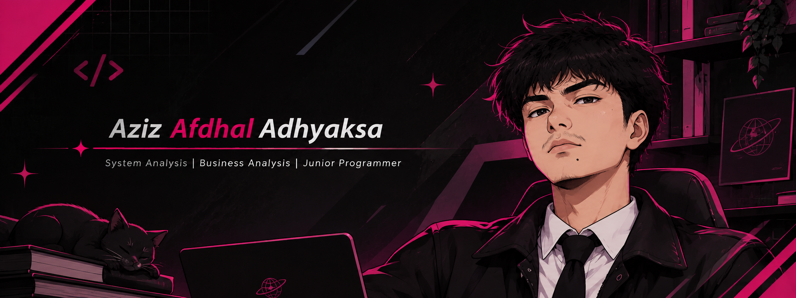

## Hi, I'm Aziz

Information Systems graduate from Universitas Gunadarma.
I am looking for a Business Analyst / System Analyst internship.

### About me
I like turning user problems into clear requirements and simple system designs.
In my thesis project, BekasButClassy, I did the analysis, design, build, and testing.

### Featured projects
- **BekasButClassy**: thrift marketplace website. Requirements, UML, database design, product recommendation (Jaccard Similarity), and UAT with 30 users.
- **BegsRunning**: running tracker app. User stories and README documentation. Also used to practice programming logic and fundamentals.

### Learning by building
- **English Learning App**: web app to practice English through song lyrics (typing and translation). A personal project to practice programming logic and fundamentals.

### What I do
- Requirement analysis, user stories, and acceptance criteria
- UML (use case, activity), flowcharts, database design
- Testing: black box and UAT

---
## 💻 Tech Stack:
              

Also: SQL (basic)

## 📚 Currently learning
SQL · Jira · English 

---
## 🌐 Socials:
 

<!-- Proudly created with GPRM ( https://gprm.itsvg.in ) -->